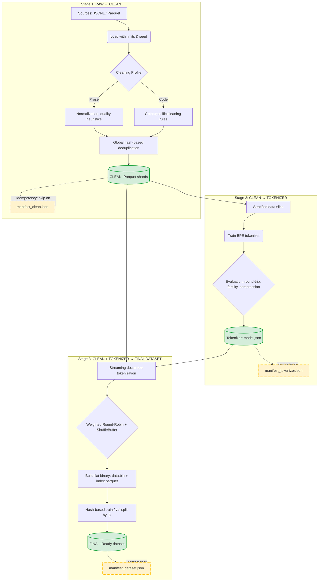

# Data for LLM: End-to-End Data Preparation Pipeline

[](https://www.python.org/)
[](LICENSE.txt)
[](https://github.com/astral-sh/uv)

A professional, reproducible, and scalable data preparation pipeline for training Large Language Models (LLMs).  
From raw text to an optimized binary dataset with full control over language ratios, data sources, and token budgets.

## Project Goal

To achieve **complete control over training data** for LLMs. The pipeline enables assembling a unified, cleaned dataset from open or local sources, training a custom tokenizer tailored to it, and building the final flat dataset with strict adherence to token quotas.

The entire workflow is reproducible, well-documented, and backed by hash-verified manifests.

> **Philosophy:** At constrained model scales (e.g., 126M–1B parameters), data quality matters far more than sheer quantity. This pipeline follows a "thought → code" principle—built from first principles using industry best practices rather than blind copy-pasting.

---

## Key Features

- **Idempotency** — Every stage verifies hashes of input data and configurations. If nothing has changed, the stage is skipped.
- **Memory Efficiency** — Streaming processing powered by PyArrow and Parquet keeps memory usage strictly bounded by batch size.
- **Precise Ratio Control** — Weighted Round-Robin + ShuffleBuffer ensure the final dataset strictly matches target proportions.
- **Strict Budget Enforcement** — Dataset assembly stops precisely upon reaching `target_tokens`.
- **Detailed Telemetry** — Each stage generates a `manifest.json` containing comprehensive statistics and metadata.
- **Cross-Platform Support** — Reliable UTF-8 handling across operating systems (including Windows).

---

## Pipeline Architecture

The pipeline consists of three independent yet interconnected stages:



---

# Project Structure
```
data_for_llm/
├── configs/                # YAML configurations (sources, ratios, limits)
├── scripts/                # CLI entry points
│   ├── pipeline.py         # Main orchestrator
│   ├── tokenize_cleaned.py
│   └── build_final_dataset.py
├── src/
│   ├── common/             # Utilities (config, logger, paths)
│   ├── dataset/            # Core data processing
│   │   ├── io/
│   │   ├── cleaning/
│   │   └── sampling/
│   └── tokenizer/          # Tokenizer training and validation
├── tests/
├── .env.example
├── pyproject.toml
└── uv.lock
```

---

# Installation
```
git clone https://github.com/Gigilocha/data_for_llm.git
cd data_for_llm

uv sync
cp .env.example .env
```

### Edit the files in configs/ to match your data sources, proportions, and token budgets.

---

# Usage

### Full Pipeline
```
uv run scripts/pipeline.py --stage all
```

### Individual Stages
```
# Stage 1: Cleaning and deduplication
uv run scripts/pipeline.py --stage cleaned

# Stage 2: Tokenizer training
uv run scripts/pipeline.py --stage tokenizer

# Stage 3: Tokenization and final dataset assembly
uv run scripts/pipeline.py --stage final
```

---

# Outputs
```
output/
├── cleaned/          # Cleaned texts (parquet)
├── tokenizer/        # tokenizer.json + manifest.json
├── tokenized/        # Tokenized texts (parquet)
└── dataset/
    ├── train/
    │   ├── data.bin
    │   └── index.parquet
    └── val/
        └── ...
```

---

# Key Concepts

| Concept | Concept |
| --- | --- |
| Character Budget | During the cleaning stage, text is collected based on character count (target_tokens × share × chars_per_token × overshoot)|
| Token Budget | During the assembly stage, exactly target_tokens × share tokens are collected |
| Weighted Round-Robin | Selects the next document from whichever language/source is furthest behind its target budget |
| ShuffleBuffer | Accumulates documents, shuffles them, and yields batches without splitting individual documents|
| BOS / EOS | Every document is wrapped in <|bos|> and <|eos|> tokens |

---

# Testing
```
# Fast unit tests
pytest -m unit

# All tests
pytest
```

---

# License

MIT

---

# Author

This project is developed as part of an independent deep dive into ML/LLM Engineering. Every component is implemented with a clear understanding of the "why" behind each design choice—without blind copy-pasting.

Telegram: t.me/Gigilocha