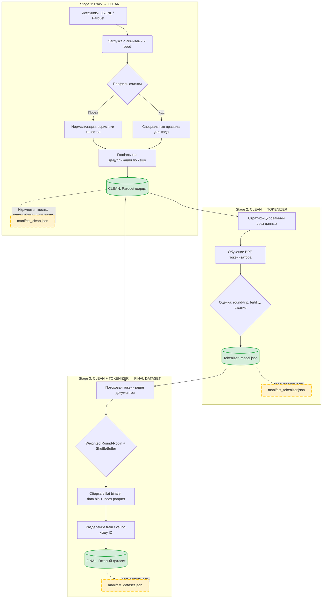

# Data for LLM: End-to-End Data Preparation Pipeline

[](https://www.python.org/)
[](LICENSE.txt)
[](https://github.com/astral-sh/uv)

Профессиональный, воспроизводимый и масштабируемый пайплайн для подготовки данных обучения больших языковых моделей (LLM).  
От сырых текстов до оптимизированного бинарного датасета с полным контролем над пропорциями языков, источников и токенов.

## Цель проекта

Получить **полный контроль над данными** для обучения LLM. Пайплайн позволяет из открытых или локальных источников собрать единый очищенный датасет, обучить под него кастомный токенизатор и сформировать итоговый плоский (flat) датасет с гарантированным соблюдением токеновых квот.

Весь процесс воспроизводим, задокументирован и поддерживается манифестами с хэшами.

> **Философия:** При ограниченном размере модели (например, 126M–1B параметров) качество данных важнее их количества. Этот пайплайн реализует принцип «мысль → код» без слепого копирования, с использованием лучших практик индустрии.

---

## Ключевые особенности

- **Идемпотентность** — каждый этап проверяет хэши входных данных и конфигурации. Если ничего не изменилось, этап пропускается.
- **Эффективность памяти** — потоковая обработка с использованием PyArrow и Parquet. Потребление памяти ограничено размером батча.
- **Точный контроль пропорций** — Weighted Round-Robin + ShuffleBuffer гарантируют, что итоговый датасет точно соответствует заданным пропорциям.
- **Строгий контроль бюджета** — сборка останавливается при достижении `target_tokens`.
- **Детальная телеметрия** — на каждом этапе генерируется `manifest.json` со статистикой.
- **Кроссплатформенность** — корректная работа с UTF-8 (включая Windows).

---

## Архитектура пайплайна

Пайплайн состоит из трёх независимых, но связанных этапов:



---

# Структура проекта
```
data_for_llm/
├── configs/                # YAML-конфигурации (источники, пропорции, лимиты)
├── scripts/                # Точки входа (CLI)
│   ├── pipeline.py         # Главный оркестратор
│   ├── tokenize_cleaned.py
│   └── build_final_dataset.py
├── src/
│   ├── common/             # Утилиты (config, logger, paths)
│   ├── dataset/            # Ядро работы с данными
│   │   ├── io/
│   │   ├── cleaning/
│   │   └── sampling/
│   └── tokenizer/          # Обучение и валидация токенизатора
├── tests/
├── .env.example
├── pyproject.toml
└── uv.lock
```

---

# Установка
```
git clone https://github.com/Gigilocha/data_for_llm.git
cd data_for_llm

uv sync
cp .env.example .env
```

### Отредактируйте файлы в configs/ под свои источники данных, пропорции и токеновые бюджеты.

---

# Использование

### Полный цикл
```
uv run scripts/pipeline.py --stage all
```

### Отдельные этапы
```
# Этап 1: Очистка и дедупликация
uv run scripts/pipeline.py --stage cleaned

# Этап 2: Обучение токенизатора
uv run scripts/pipeline.py --stage tokenizer

# Этап 3: Токенизация и сборка финального датасета
uv run scripts/pipeline.py --stage final
```

---

# Выходные данные
```
output/
├── cleaned/          # Очищенные тексты (parquet)
├── tokenizer/        # tokenizer.json + manifest.json
├── tokenized/        # Тексты в виде токенов (parquet)
└── dataset/
    ├── train/
    │   ├── data.bin
    │   └── index.parquet
    └── val/
        └── ...
```

---

# Ключевые концепции

| Концепция | Описание |
| --- | --- |
| Бюджет в символах | На этапе очистки набираем тексты в символах (target_tokens × share × chars_per_token × overshoot) |
| Бюджет в токенах | На этапе сборки набираем ровно target_tokens × share токенов |
| Weighted Round-Robin | Берём документ из того языка/источника, который сильнее всего отстаёт от бюджета |
| ShuffleBuffer | Накапливает документы, перемешивает и отдаёт пачками (не разрывая документы) |
| BOS / EOS | Каждый документ оборачивается в <\|bos\|> и <\|eos\|> |

---

# Тестирование
```
# Быстрые unit-тесты
pytest -m unit

# Все тесты
pytest
```

---

# Лицензия

MIT

---

# Автор

Проект развивается в рамках самостоятельного изучения ML/LLM Engineering.Каждый компонент реализован с пониманием «почему именно так» — без слепого копирования.

Telegram: [t.me/Gigilocha](https://t.me/Gigilocha)