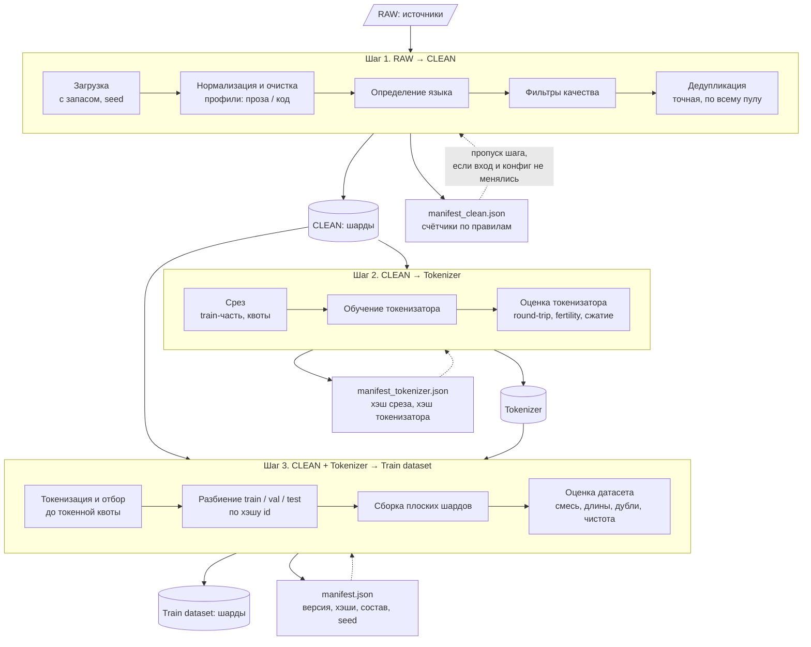
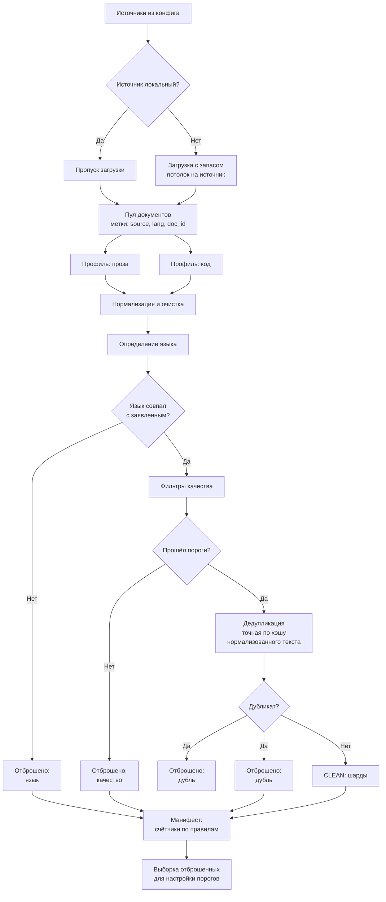
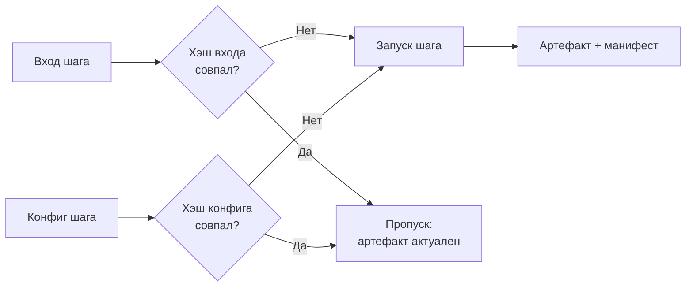

# Пайплайн подготовки данных для обучения LLM (В разработке)

## Цель

Получить полный контроль над данными для обучения LLM: из открытых или локальных
источников собрать единый очищенный датасет с заданным составом и обученным под
него токенизатором. Весь результат воспроизводим и описан отчётом.

## Идея

Собрать данные из источников, очистить, отфильтровать и дедуплицировать их,
набрать выборку в нужных пропорциях и получить готовый плоский датасет, чтобы
обучение модели начиналось с готовых данных и не требовало их подготовки.

Идея возникла при обучении небольшой мультиязычной модели на 126M параметров:
при ограниченном размере модели качество данных даёт больше, чем их количество.

## Результат работы

1. Сбор и очистка датасета обучения токенизатора. 
2. Оценка датасета обучения токенизатора.
3. Обученный токенизатор.
4. Оценка токенизатора.
5. Сбор и очистка датасета обучения модели.
6. Оценка датасета обучения модели.
7. Манифест: версия пайплайна, хэши конфига и токенизатора, состав данных, seed.

---

## Этапы пайплайна

Пайплайн состоит из трёх шагов. Каждый шаг читает результат предыдущего, пишет
свой результат и манифест (счётчики, хэши входа и конфига). Если вход и конфиг
шага не менялись, шаг пропускается, поэтому любой шаг можно перезапустить, не
трогая предыдущие. Внутри шага данные обрабатываются потоком, шардами, поэтому
потребление памяти ограничено размером шарда.

### Шаг 1. RAW → CLEAN: загрузка и очистка

Задача: получить общий очищенный пул данных с метками (источник, язык, id).

1) Загрузка. Источники задаются в конфиге (локальный путь или ссылка в сети).
   Для локальных данных шаг пропускается. Загружается с запасом, потолок на
   источник задаётся в конфиге. Документы набираются случайно, с фиксированным seed.
2) Нормализация и базовая очистка. Для прозы и для кода используются разные
   профили правил: код нельзя чистить как прозу.
3) Определение языка. Документы, язык которых не совпал с заявленным,
   отбрасываются.
4) Фильтры качества. Эвристики по длине, доле букв, повторам. Пороги в конфиге.
5) Дедупликация. Точная, по хэшу нормализованного текста, по всему пулу.

Результат: очищенный пул в шардах, манифест со счётчиками по каждому правилу,
выборка отброшенных документов (для настройки порогов).

### Шаг 2. CLEAN → токенизатор

Задача: получить токенизатор, обученный на срезе пула, и проверить его.

1) Срез. Берётся случайная подвыборка только из train-части (разбиение
   по хэшу id документа). Состав среза задаётся в конфиге, по умолчанию
   равен целевому миксу. Единица квоты: символы или байты (параметр конфига).
2) Обучение токенизатора (размер словаря, спецсимволы, byte fallback в конфиге).
3) Оценка токенизатора. Обязательная проверка: encode → decode без потерь.
   Метрики: токенов на слово по языкам, степень сжатия, доля неизвестных и
   байтовых токенов, сравнение с существующими токенизаторами.

Если используется готовый токенизатор, шаг пропускается.

Результат: токенизатор и манифест (хэш среза, хэш токенизатора, размер словаря).

### Шаг 3. CLEAN + токенизатор → готовый датасет

Задача: собрать итоговый плоский датасет с заданным распределением по токенам.

1) Токенизация и сбор. Для каждого источника шарды читаются в случайном порядке,
   документы токенизируются, и отбор идёт, пока не набрана токенная квота.
   Если источник не набрал квоту, это отражается в отчёте, данные не повторяются.
2) Выделение val и test по хэшу id документа.
3) Сборка плоского датасета в шарды.
4) Оценка датасета: токены по источникам и языкам, отклонение от целевой смеси,
   распределение длин, доля дублей, чистота языка, отсутствие пересечений
   между train, val и test.

Результат: токенизированный датасет в шардах, отчёт об оценке, итоговый
манифест (версия пайплайна, хэши конфига и токенизатора, состав данных, seed).

---

## Очистка данных

---

## Визуализация 
### Основной поток пайплайна


### Внутренняя структура Шага 1 (детально)


### Логика «пропуска шага» (идемпотентность)


---

## Структура проекта
```
```

## Технические особенности

---

## Использование / Запуск

---

## Пример использования
Цель: получить плоский очищенные мультиязычный датасет из 3 языков (RUS / EN / CODE) для обучения LLM

Входные данные:
1) Список источников: 
    1) RUS: 
        ссылка 1
        ссылка 2
    2) EN:
        ссылка 1
        ссылка 2
    3) CODE:
        ссылка 1
2) Пропорции датасетов внутри одного языка в процентах: 
    1) RUS: 50 / 50
    2) EN: 60 / 40
    3) CODE: 100
3) Пропорции между языками: 60 / 20 / 20
4) Конечное число токенов: 3 000 000 000

Выходные данные:
1) Плоский очищенный мультиязычный датасет
2) Токенизатор обученый на подвыборке датасета

---

## Автор
Разработка ведётся в рамках самостоятельного изучения ML/LLM engineering.
Каждый компонент реализую с пониманием «почему именно так», чтобы не изобретать велосипед, компоненты, что есть в готовых библиотеках берутся из них. Собственная логика пишется самостоятелньо по теории "мысль -> код". Никакого пустого копирования из LLM без понимая.

Мои мысли и ход работы освещяется в телеграмм канале SkinAI: [t.me/SkinAI_KSE]

---

## Мысли автора
Данный проект должен стать одной из шестеренок полноценного пайплайна обучения языковых генеративных моделей. Этот проект должен полностью закрыть проблему подготовки данных для обучения.

## Связь с автором
Email: [Gigilocha@yandex.ru]

Telegram: [t.me/Gigilocha]


